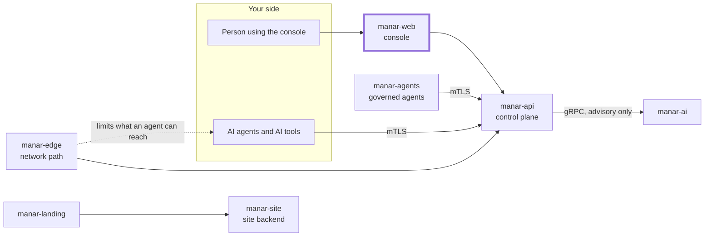

# manar-web

The Manar operator console (Next.js 16, React, Tailwind, next-intl with English and Arabic and right-to-left layout).

## Where it fits in Manar

Manar is a control plane that governs AI agents and AI tools: who an agent is, what it may do,
who approves risky actions, and a tamper-evident record of what happened. This repository is the
thick-bordered box of the picture below; the other parts live in their own repositories under
[github.com/manarhq](https://github.com/manarhq).



## What it does

The console is the place where people work with Manar: overview, AI systems, agents, tasks,
tools, approvals, policies, audit, incidents, compliance, live activity, integrations, users,
roles and settings. Every user-facing string is in `messages/en` and `messages/ar`.

It talks to [manar-api](https://github.com/manarhq/manar-api) through server-side routes under
`app/api/`; the browser never holds the Keycloak access token (see
[docs/auth-flow.md](docs/auth-flow.md)). The API client types in `lib/api/schema.d.ts` are
generated from manar-api's OpenAPI document and are not edited by hand.

## Quickstart (developers)

Needs Node 24 and pnpm 11. For a working sign-in and data you also need a running manar-api and
Keycloak (the Compose stack in `manar-api/deploy/docker-compose.yml`).

```bash
pnpm install
cp .env.example .env.local     # placeholders only
pnpm dev                       # http://localhost:4200
```

```bash
pnpm lint && pnpm format:check
pnpm typecheck
pnpm test
pnpm build
pnpm api:codegen               # regenerate the API client from a running manar-api
```

## Licence and links

Licensed under the [Apache License 2.0](LICENSE). Copyright 2026 Fixio; see [NOTICE](NOTICE).
Contributions need a DCO sign-off: [CONTRIBUTING.md](CONTRIBUTING.md). Report vulnerabilities
privately: [SECURITY.md](SECURITY.md). The Manar name and logo are trademarks of Fixio:
[TRADEMARK.md](TRADEMARK.md). Everyone taking part follows the [Code of Conduct](CODE_OF_CONDUCT.md).

Product site: <https://manar.vax.sh>
